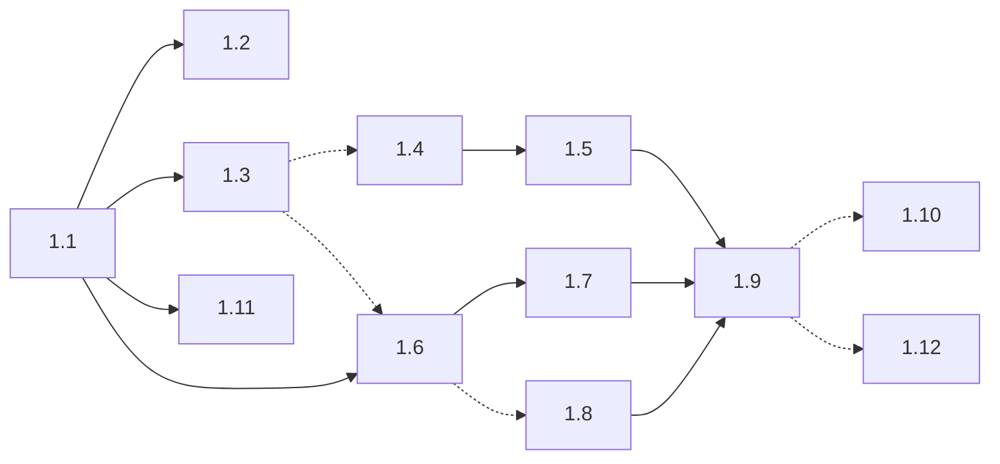

# Step 1 — Sub-task dependencies and merge-conflict risk

Each sub-task of [`MIGRATION-STEP-1.md`](./MIGRATION-STEP-1.md) is one PR.
This page explains which sub-tasks depend on which, which ones touch the same
files, and so which PRs can be worked on at the same time without merge
conflicts. The file lists come from the todo list of each sub-task.

## Three kinds of dependency

A sub-task can need another one for three different reasons:

| Kind | Meaning | Example | Consequence |
|---|---|---|---|
| **Code** | its code uses something the other one adds | 1.6 includes the `network_domains` role of 1.1 | start after the other PR is merged |
| **Check** | its code is independent, but its ✋ check needs the other feature | the check of 1.6 runs a scenario C test, which needs the `EXPOSE_*` injection of 1.3 | the code can be written in parallel; the check and the merge wait for the other PR |
| **Files** | both change the same file | 1.4 and 1.5 both change the console tasks | no logical dependency, but in parallel they conflict: do them one after the other |

## Files changed by each sub-task

| Sub-task | Files |
|---|---|
| 1.1 `network_domains` | `roles/network_domains/` (new); `roles/fabric_console/tasks/create.yml`; `roles/hlfsupport_console/tasks/create.yml`; `roles/endorsing_organization/tasks/{create,delete}.yml`; `roles/ordering_organization/tasks/{create,delete}.yml`; `tutorial/00-deploy-fabric-console.yml`; `roles/fabric_operator_crds/defaults/main.yml`; `tutorial/common-vars.yml`; `plan/move-ingress/MIGRATION-STEP-1.md` (organization-role correction found while implementing) |
| 1.2 rule tests | `tests/network_domains/` (new: `test.yml`, `test_case.yml`, `test_extra_vars.yml`, `run.sh`); `.github/workflows/fvtest.yml` (one step); `plan/move-ingress/MIGRATION-STEP-1.md` (check 1.2 only) |
| 1.3 variable injection | `.github/scripts/run-tests.sh`; `.github/scripts/deploy-console.sh`; their shared patching helper `.github/scripts/scenario-vars.sh` (new); `tutorial/00-deploy-fabric-console.yml` (`network_domains` include moved to `pre_tasks`); `plan/move-ingress/MIGRATION-STEP-1.md` (1.3 text only) |
| 1.4 console wait | `roles/fabric_console/tasks/k8s/create.yml`; `roles/hlfsupport_console/tasks/k8s/create.yml`; `tutorial/00-deploy-fabric-console.yml`; `roles/network_domains/tasks/console_not_exposed.yml` (new, shared by the three); `plan/move-ingress/MIGRATION-STEP-1.md` (1.4 text only) |
| 1.5 `IBPConsole` fields | console templates (`roles/fabric_console/templates/`, `roles/hlfsupport_console/templates/`); console tasks `{k8s,openshift}/{create,delete}.yml` of both console roles; `tutorial/00-deploy-fabric-console.yml`; `roles/network_domains/tasks/console_domain_change.yml` (new, F1); `plan/move-ingress/MIGRATION-STEP-1.md` (1.5 text only) |
| 1.6 per-endpoint Services | `roles/k8s_endpoint_services/` (new); `roles/endorsing_organization/tasks/{create,delete}.yml`; `roles/ordering_organization/tasks/{create,delete}.yml`; `docs/source/roles/` (new page, listed by a glob: no index change) |
| 1.7 node Ingress neutralization | `roles/endorsing_organization/tasks/create.yml`; `roles/ordering_organization/tasks/create.yml` |
| 1.8 CoreDNS rewrites | `.github/scripts/kind_with_nginx.sh` |
| 1.9 CI legs and Job | `.github/workflows/fvtest.yml`; `.github/docker/ansible-runner/Dockerfile` (new); `.github/k8s/ansible-runner-{rbac,job}.yml` (new) |
| 1.10 reachability assertions | `.github/scripts/verify-unexposed-reachability.sh` (new); `.github/workflows/fvtest.yml` (one step) |
| 1.11 tutorial, everything exposed | `docs/source/tutorials/` (a section in `oss-installing.rst`, or a new page plus one line in `docs/source/index.rst`) |
| 1.12 tutorial, nothing exposed | `docs/source/tutorials/nginx-no-expose.rst` (new); `docs/source/index.rst` (one line) |

## Files shared by several sub-tasks

These are the only places where two PRs can conflict:

| File | Sub-tasks | How they are ordered |
|---|---|---|
| organization roles, `tasks/create.yml` | 1.1, 1.6, 1.7 | one after the other (code dependency anyway) |
| organization roles, `tasks/delete.yml` | 1.1, 1.6 | one after the other |
| `tutorial/00-deploy-fabric-console.yml` | 1.1, 1.3, 1.4, 1.5 | one after the other (1.4 needs 1.3; 1.2 and 1.11, in parallel with 1.3, don't touch it) |
| console roles, `tasks/k8s/create.yml` | 1.4, 1.5 | one after the other |
| `.github/workflows/fvtest.yml` | 1.2, 1.9, 1.10 | 1.2 early; 1.10 after 1.9 |
| `docs/source/index.rst` | 1.11 (if new page), 1.12 | one toctree line each: trivial to rebase |

## Dependencies per sub-task

| Sub-task | Code needs | Check needs | Same files as | Can run in parallel with |
|---|---|---|---|---|
| 1.1 | — | — | 1.4, 1.5, 1.6, 1.7 (merged before them) | — |
| 1.2 | 1.1 (tests its rules) | — | 1.9, 1.10 (`fvtest.yml`, later) | 1.3, 1.11 |
| 1.3 | 1.1 (variable names; check step 4 expects a V3 failure) | — | — | 1.2, 1.11 |
| 1.4 | 1.1 (`console_url`, `console_incluster_url`) | 1.3 (`EXPOSE_CONSOLE` through `deploy-console.sh`) | 1.5 | 1.6 |
| 1.5 | 1.1 (`hlf_node_domain`); 1.4 (wait without the Ingress, needed to deploy a scenario B console) | 1.3 | 1.4 | 1.6, 1.7, 1.8 |
| 1.6 | 1.1 (`network_domains` include, `verify_urls`) | 1.3 (scenario C run) | 1.7 | 1.4, 1.5 |
| 1.7 | 1.6 (CR names read from the returned URLs, same tasks) | 1.3 (`NEUTRALIZE_NODE_INGRESSES`, `RUN_TESTS_MODE=patch`) | 1.6 | 1.8, 1.5 |
| 1.8 | — (script only, reads environment variables) | 1.6 (resolution checked against the Services) | — | 1.7, 1.5 (its code could even start with 1.6) |
| 1.9 | 1.3 (`KEEP_NETWORK`, `RUN_TESTS_MODE`, `TEST_RUN_ID`) | 1.4 to 1.8 (B and C end to end) | 1.2, 1.10 | — |
| 1.10 | — (new script) | 1.9 (network built by the Job) | 1.9 (`fvtest.yml`, merged before) | 1.12 |
| 1.11 | 1.1 (the variables it documents) | — | 1.12 (`index.rst`, only with a new page) | everything from 1.2 on |
| 1.12 | — | 1.9 (scenario B runs in-cluster) | 1.11 (`index.rst`) | 1.10 |

Solid arrow: code or file dependency. Dashed arrow: only the check needs the
other sub-task.

## Waves

| Wave | PRs in parallel | Starts when |
|---|---|---|
| 1 | 1.1 | — |
| 2 | 1.2, 1.3, 1.11 | 1.1 merged |
| 3 | 1.4 then 1.5, and in parallel 1.6 | 1.3 merged |
| 4 | 1.7, 1.8 (1.5 may still be running) | 1.6 merged |
| 5 | 1.9 | 1.4 to 1.8 merged |
| 6 | 1.10, 1.12 | 1.9 merged |

Critical path: 1.1 → 1.3 → 1.6 → 1.7 or 1.8 → 1.9 → 1.10 or 1.12.

## Changes made to the plan to keep the parallel PRs apart

Three todo items were in the wrong sub-task and would have made parallel PRs
touch the same files:

| Item | Was in | Now in | Why |
|---|---|---|---|
| Port the prototype tests of `network_domains` | 1.1 and 1.2 | 1.2 only | 1.1 and 1.2 would both have added the same files |
| Neutralized case of assertion 1 | 1.7 | 1.10 | 1.7 would have changed a script that only exists after 1.10 |
| Export `EXPOSE_*`, `NAMESPACE`, `HLF_NETWORK_DOMAIN`, `CLUSTER_DOMAIN` in `fvtest.yml` | 1.8 | 1.9 | 1.8 would have changed `fvtest.yml`, which 1.9 rewrites |

## Rules to keep conflicts rare

- Before opening a PR, and before merging it, rebase it on the target branch.
- A PR only changes the files listed for its sub-task above. If it needs
  another file, check this page first: it may change who can run in parallel.
- The check of every sub-task ends with this verification: it lists the
  files the PR changes, compares them with the table above and, for a file
  that is not listed, with the PRs of the same wave. A conflict is raised as a
  warning in the PR (merge before or after the other sub-task), and the table
  is updated.
- When a PR merges, rebase the other open PRs that share a file with it (see
  "Files shared by several sub-tasks").
