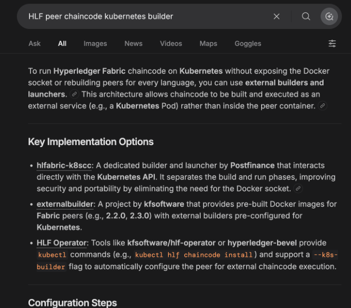
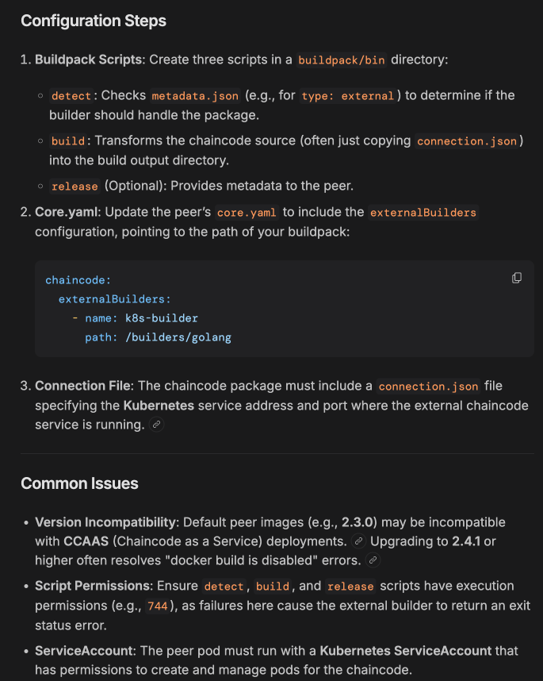

# Remaining TODO

Things we should do but that are not part of a step yet. Most come from the
Step 0 run of 2026-10-21 ([review](./REVIEW-MIGRATION-PLAN-STEP-0.md)).

## Tests and CI

### 1. Choose how the tutorial chaincode is built

Today `deploy_smart_contract.sh` always runs the chaincode as a service
(CCaaS, `tutorial/deploy_chaincode_server.sh`). The other way is to let the
peer start the chaincode itself with its `k8s_builder`. We want one parameter
to choose between the two.

**The parameter**

| | |
|---|---|
| Name | `chaincode_build_mode` in `tutorial/common-vars.yml`. In CI and with `run-tests.sh`: `CHAINCODE_BUILD_MODE`, written to `common-vars.yml` like the other variables (Step 1 sub-task 1.3). |
| Values | `ccaas` (default, today's behaviour) or `k8s_builder` |
| Other value | `deploy_smart_contract.sh` and `deploy-console.sh` stop with an error naming the two values |
| When it must be set | **before the console is deployed**: the peer image is chosen when the console is created, not when the chaincode is installed |

**What each value does**

| | `ccaas` (today) | `k8s_builder` |
|---|---|---|
| Who starts the chaincode | we do: a Deployment and a Service (`deploy_chaincode_server.sh`) | the peer, through its `k8s_builder` |
| Chaincode image | built and pushed to the KIND registry | the same |
| Package (`smart_contract_package`) | `type: ccaas`, holding the address of the chaincode server | `type: k8s`, pointing to the chaincode image (name and digest) |
| Peer image | the console's default, `hyperledger/fabric-peer:2.5.8` (only `ccaas_builder`) | an image that ships the builder (`k8s-fabric-peer`), set in `00-deploy-fabric-console.yml` |
| Destroy (`join_network.sh destroy`) | deletes the Deployment, the Service and the package | deletes the package; check what removes the chaincode pods |
| CI | `fvtest.yml` as today | a later leg, once the mode works locally |

The peer is already allowed to create its chaincode pods: the Role the
operator creates for each peer (`definitions/peer/role.yaml`) grants
`create`, `delete`, `get`... on `pods` and `secrets` in its namespace
(checked on a live peer).

Files: `deploy_smart_contract.sh`, `deploy_chaincode_server.sh`,
`join_network.sh` (destroy), `00-deploy-fabric-console.yml` (peer image),
`common-vars.yml`.

**TODO: check how to set up the chaincode Kubernetes builder.**

- Builders to compare:
  - `fabric-builder-k8s` (Hyperledger Labs): ships the `k8s-fabric-peer`
    image, peer with the builder already installed;
  - `hlfabric-k8scc` (PostFinance): builds and launches the chaincode through
    the Kubernetes API, without the Docker socket;
  - `externalbuilder` (kfsoftware): peer images with external builders
    preconfigured, but for old Fabric versions (2.2, 2.3);
  - `hlf-operator` (kfsoftware) and Hyperledger Bevel do it with their own
    tooling (`kubectl hlf chaincode install`, `--k8s-builder`): not usable as
    is with the Fabric Operator, but worth reading.
- How an external builder plugs into the peer:
  - a directory with `bin/detect`, `bin/build` and `bin/release` (optional),
    executable: a wrong permission makes the builder fail;
  - an entry in `chaincode.externalBuilders` of the peer's `core.yaml`
    (`name`, `path`). The operator's `core.yaml` (`v25`) already lists
    `k8s_builder`: check which path it expects, and how to give the peer
    another image through the console (`versions` / images of the
    `IBPConsole`).
  - `detect` picks the packages it accepts from the `type` in
    `metadata.json`.
- Notes from the review (search "HLF peer chaincode kubernetes builder"):
  - [Fabric docs: chaincode as an external service](https://hyperledger-fabric.readthedocs.io/en/release-2.2/cc_service.html)
  - [hlfabric-k8scc (PostFinance)](https://github.com/postfinance/hlfabric-k8scc)
  - [externalbuilder (kfsoftware)](https://github.com/kfsoftware/externalbuilder)

  

  

### 2. `TEST_RUN_ID` stamping in `run-tests.sh`

Planned in Step 0 sub-task 0.2, never done. Names are fixed, so two runs or a
leftover network collide. Take `TEST_RUN_ID` from the environment when it is
set: Step 1 runs two Jobs on the same network (sub-tasks 1.3 and 1.9).

### 3. Run `fvtest.yml` on GitHub Actions

Not done yet. The runner now builds the chaincode image and pushes it to the
KIND registry (`localhost:5000`): check that this works on the runner.
Decide whether the workflow stays `workflow_dispatch` only, or also runs on
push / pull request.

### 4. Don't modify tracked files during a test run

`run-tests.sh` patches `tutorial/common-vars.yml` and the org vars files in
place, and the playbooks write identity files (`*.json`) in `tutorial/`.
The identity files are git-ignored, the vars files are not: after a run,
`git status` shows changes you must not commit. And two runs at the same time
overwrite each other's files. Work on a copy of `tutorial/`
(or restore the vars files on exit).

## Local environment and versions

### 5. Align the versions

| | CI (`fvtest.yml`) | LDE doc | Runner image (Step 1) | Peers |
|---|---|---|---|---|
| Python | 3.10 | 3.10 | 3.9 | — |
| Fabric | 2.4.7 | 2.5.15 under a "2.4.7" heading | 2.5.9 | 2.5.8 |

Python: `fvtest.yml` moved to 3.10 on 2026-10-22. Checked locally with a fresh
3.10 venv built only from `requirements.txt`, as the CI does: full run
`exit=0`. Still on 3.9: `main.yml` and `publish.yml` (build, lint, publish)
and the collection image (`Dockerfile`, `python39`), which the Step 1 runner
image extends. Fabric: pick one version for the CLI.

### 6. Fix the LDE doc (`MIGRATION-PREREQ-LDE.md`)

- `yq`: `brew install yq` installs another tool, incompatible with `yq -yi`.
  Only the Python `yq` (`pip install yq`) works.
- Set `ANSIBLE_PYTHON_INTERPRETER` to `.venv/bin/python`, otherwise Ansible
  uses a Python without the `kubernetes` library.
- Rebuild and reinstall the collection after each change, otherwise an old
  copy in `~/.ansible/collections` is used.
- Health check: use `/ak/api/v3/health` with credentials. `/health` returns
  the UI page.
- Say it plainly: one test run at a time on a workstation.

### 7. `build_ignore` in `galaxy.yml`

`ansible-galaxy collection build` from the repository root packs `.venv/`,
`bin/`, `builders/`, `config/`, old tarballs...: 188 MB instead of a few
hundred KB. Add a `build_ignore` list.

## Docs

### 8. Step 0 sub-task 0.1 doesn't match the code

It describes an inline playbook calling `fabric_console`. CI actually runs
`tutorial/00-deploy-fabric-console.yml`, which creates an inline `IBPConsole`.
Update the text.
