# Step 1 — Scenarios A, B and C

Flow diagrams of the three scenarios handled by
[`MIGRATION-STEP-1.md`](./MIGRATION-STEP-1.md#scenarios) (design:
[`URL-MANAGEMENT-NEW.md`](./URL-MANAGEMENT-NEW.md) §4), one diagram per
component: console, CA, peers, orderers.

Scenario D (nodes exposed under their own domain, for example
`fabric.example.com`) is Step 3 and is not drawn here
(URL-MANAGEMENT-NEW.md §4.4).

Names are those of the local KIND test cluster: namespace `default`, console
`hlf-console`, CA `org1ca`, peers `org1peer` and `org2peer` (two
organizations), ordering nodes `orderingservicenode1` to `3`, chaincode server
`fabcar-ccaas` (CCaaS). In the labels:
- `D` = `127-0-0-1.nip.io`, the exposed domain (scenarios A and C);
- `S` = `default.svc.cluster.local`, the HLF node domain of scenario B.

Legend: **red** box and arrows = through nginx; **blue** = per-endpoint Service
(sub-task 1.6); **yellow** = CoreDNS endpoint rewrite (sub-task 1.8);
**purple** = operations and grpc-web endpoints; dashed = data sent back on a
stream the other side opened (events, blocks). Numbers give the order of the
steps.

Checked on live CRs: the peer gossip endpoint is `<ns>-<peer>-peer.<domain>:443`,
the operator enrolls nodes at `<ns>-<ca>-ca.<domain>:443`, and orderers have no
separate cluster port, so Raft uses `<ns>-<node>-orderer.<domain>:443`. The
console proxies the UI's CA and grpc-web requests (URL-MANAGEMENT-NEW.md §5.3).

## Summary

| Flow | A | B | C |
|---|---|---|---|
| Ansible → console REST API | nginx, from outside | Service `hlf-console`, from the in-cluster Job | same as B |
| Operator → CA (node enrollment) | nginx | Service | CoreDNS rewrite → Service |
| Console → CA, operations, grpc-web | nginx | Services | CoreDNS rewrite → Services |
| App → peer (invoke, events) | nginx | Service, from any namespace | CoreDNS rewrite → Service |
| Peer → peer (endorsement, gossip) | nginx | Service | CoreDNS rewrite → Service |
| Peer → chaincode server (CCaaS) | Service | Service | Service |
| App or gateway peer → orderer (broadcast) | nginx | Service | CoreDNS rewrite → Service |
| Orderer → orderer (Raft) | nginx | Service | CoreDNS rewrite → Service |
| Orderer → peer (block delivery) | nginx | Service | CoreDNS rewrite → Service |
| From outside the cluster | everything, through nginx | nothing (the console can be exposed by hand) | nothing |

---

## Scenario A — everything exposed, non-Kubernetes FQDNs (default)

Every name is under `D`. From outside, `D` resolves to the KIND host, and port
443 reaches nginx, which routes on the TLS SNI (SSL passthrough). Inside the
cluster, the CoreDNS wildcard sends `*.D` to nginx too. So **every internal
flow** (operator to CA, console to nodes, gossip, endorsement, broadcast, Raft,
block delivery) makes a round trip through nginx, although both ends run in
the same cluster, most often in the same namespace: one extra hop, all the
network's traffic on the ingress controller, and nothing works when it is
down. The red arrows show these internal flows.

### Console

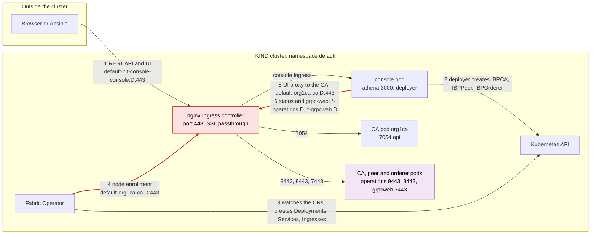

### CA

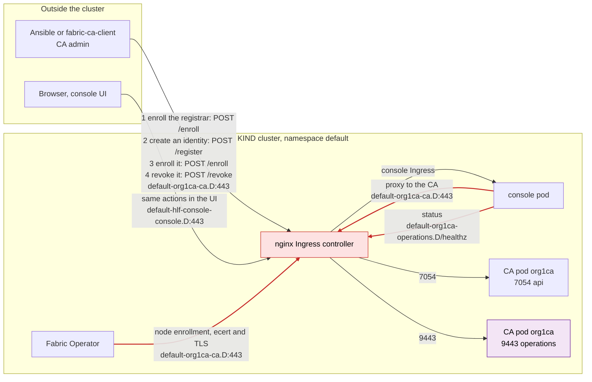

### Peers

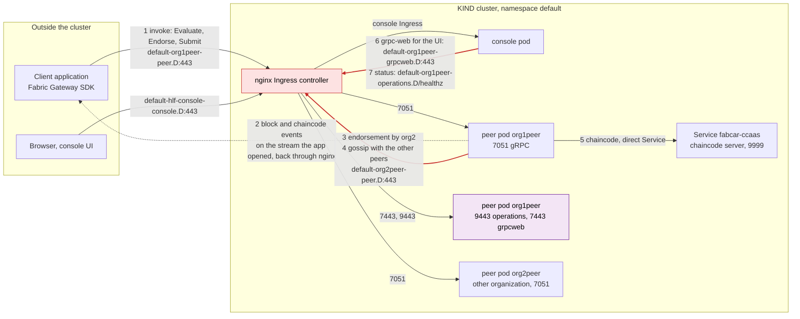

### Orderers

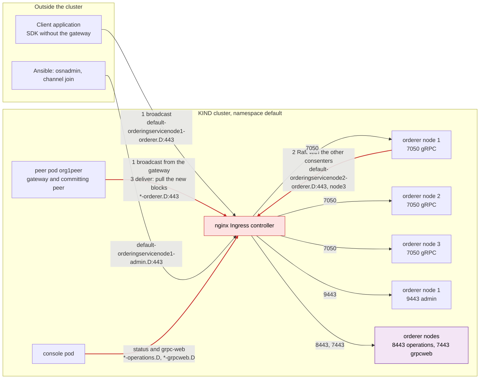

---

## Scenario B — nothing exposed, cluster-local HLF domain (Step 1 target)

The console's deployer gives every node a name under `S`
(`spec.deployer.domain`). Each name is the FQDN of a per-endpoint Service that
maps 443 to the native port, so plain kube-dns resolves it: no CoreDNS change,
no nginx. The organization playbooks run in-cluster (the `ansible-runner` Job,
sub-task 1.9). An application in another namespace reaches the nodes the same
way, if the NetworkPolicies of `default` let it in. Nothing is reachable from
outside the cluster.

### Console

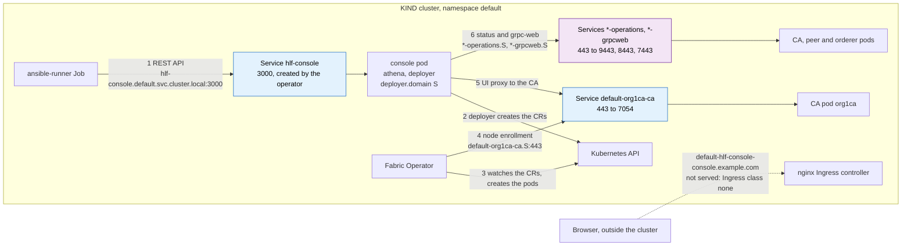

### CA

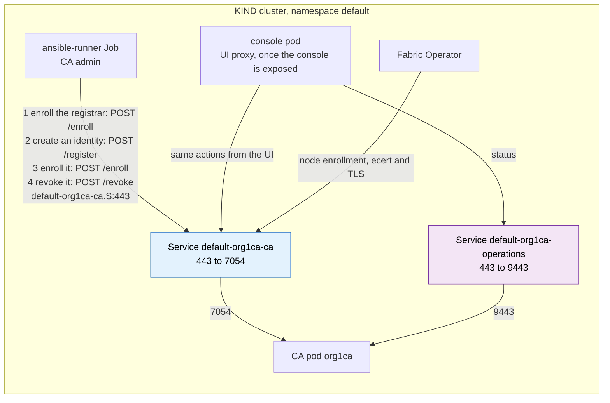

### Peers

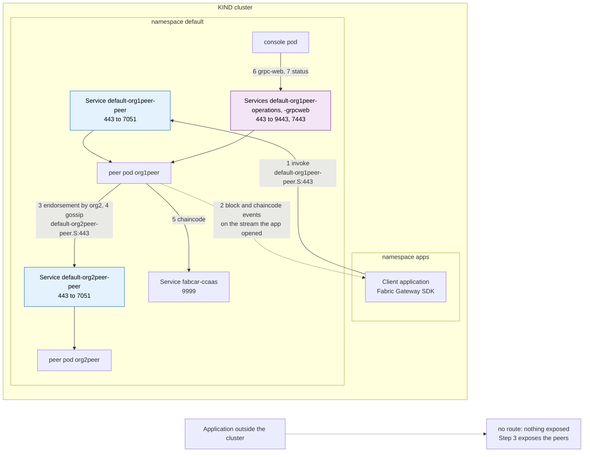

### Orderers

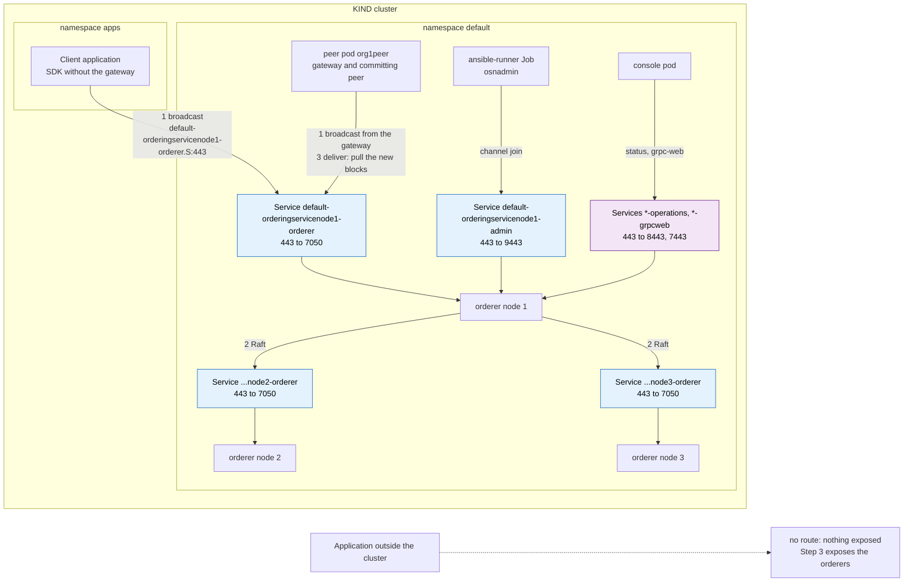

---

## Scenario C — nothing exposed, non-Kubernetes FQDNs

Same Services and same flows as B, but the nodes keep the names of A (under
`D`). Those names match no Service, so CoreDNS answers them with **one rewrite
per endpoint type**, written before the `*.D` wildcard: each name gets the IP
of its own Service, and the client keeps dialling the original name, so TLS
still matches. The rules are cluster-wide: an application in another
namespace gets the same answer. They only match the names of namespace
`default` (`^(default-[a-z0-9]+-<endpoint>)`). The console name matches no
rule: it still goes to nginx, which does not serve it (class `none`), so the
Job uses the console Service.

### Console

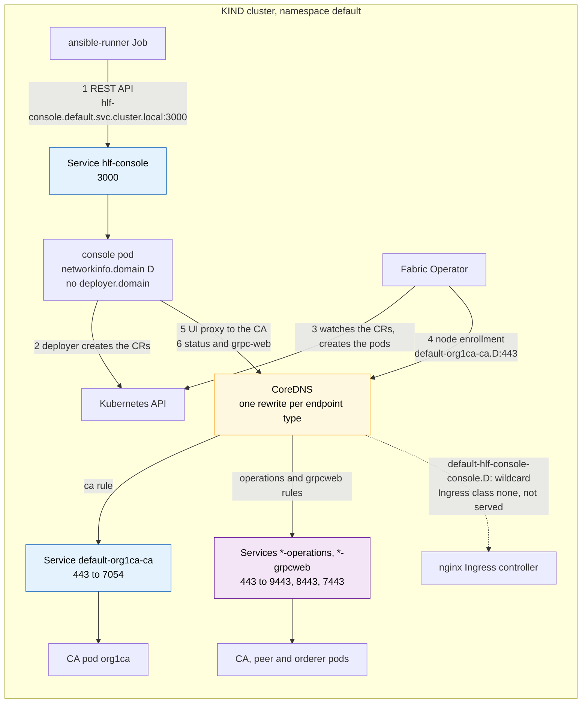

### CA

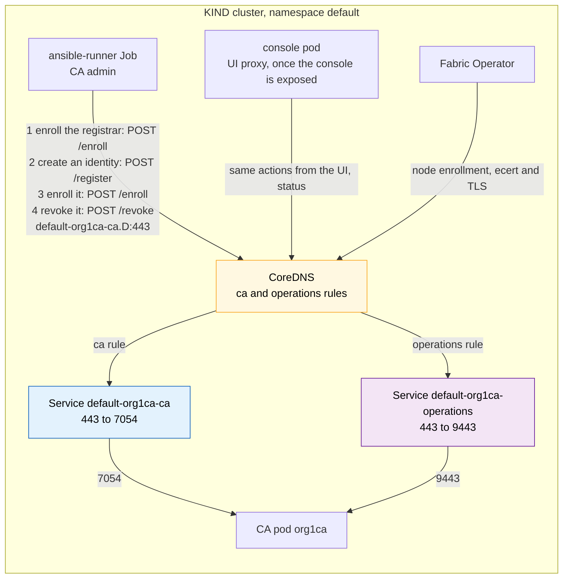

### Peers

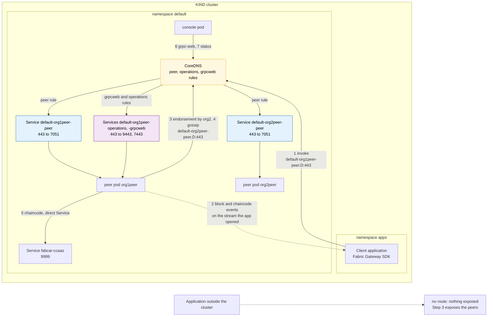

### Orderers

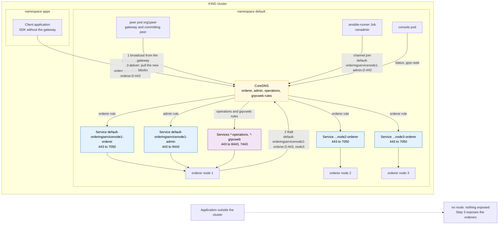
